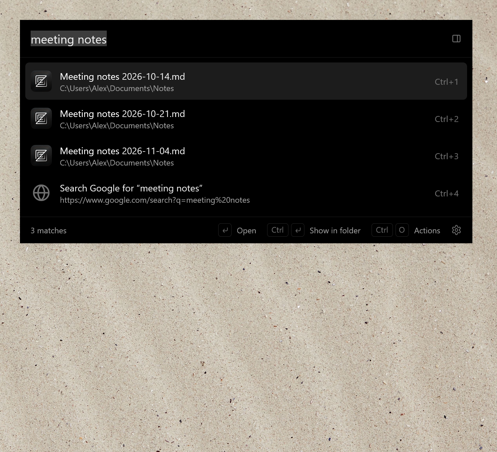
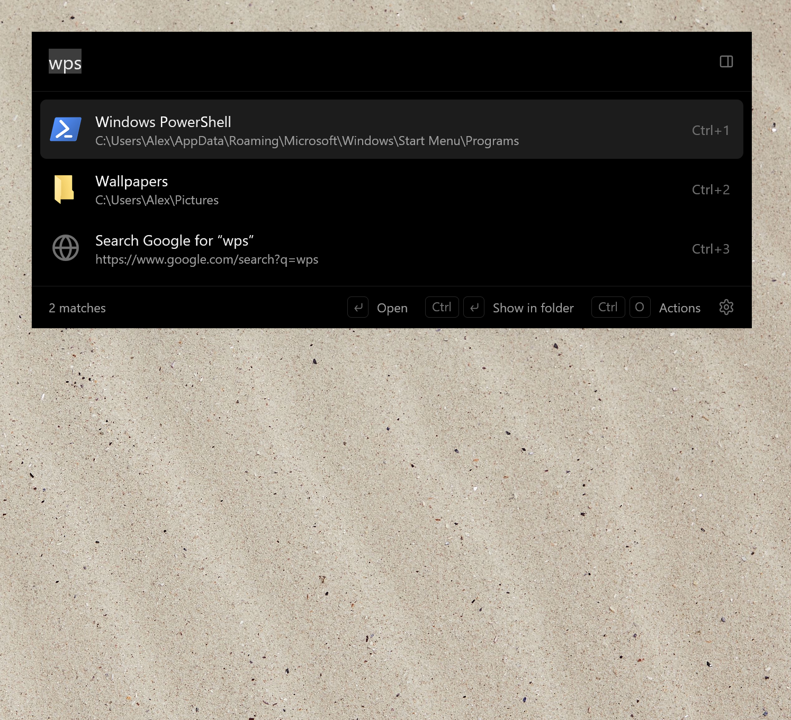
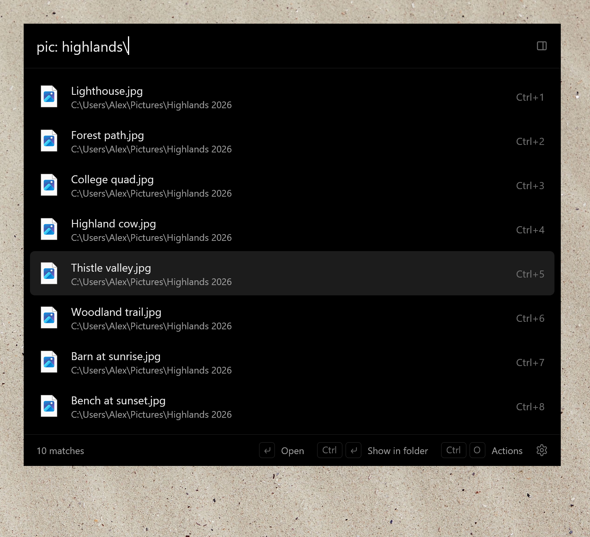
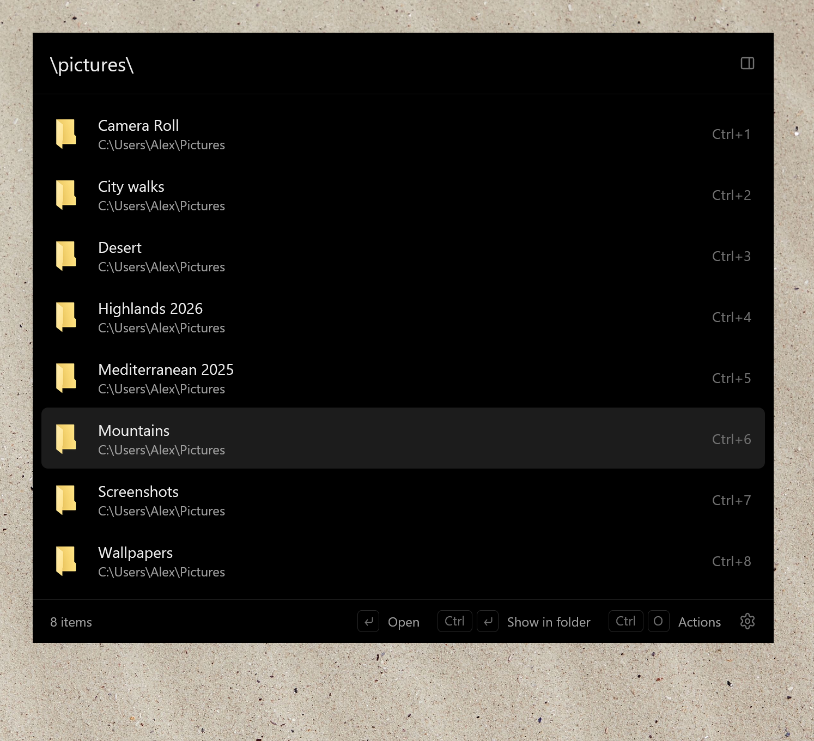
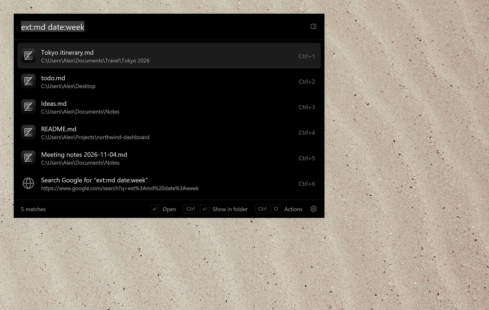
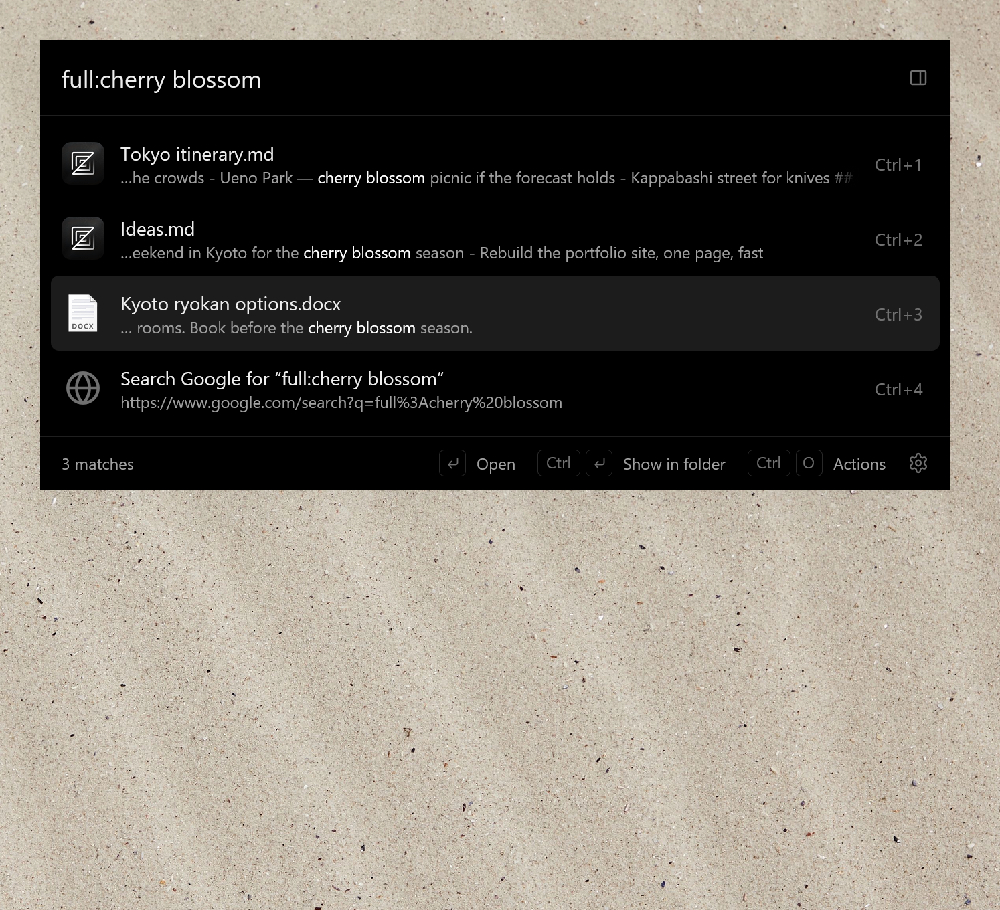
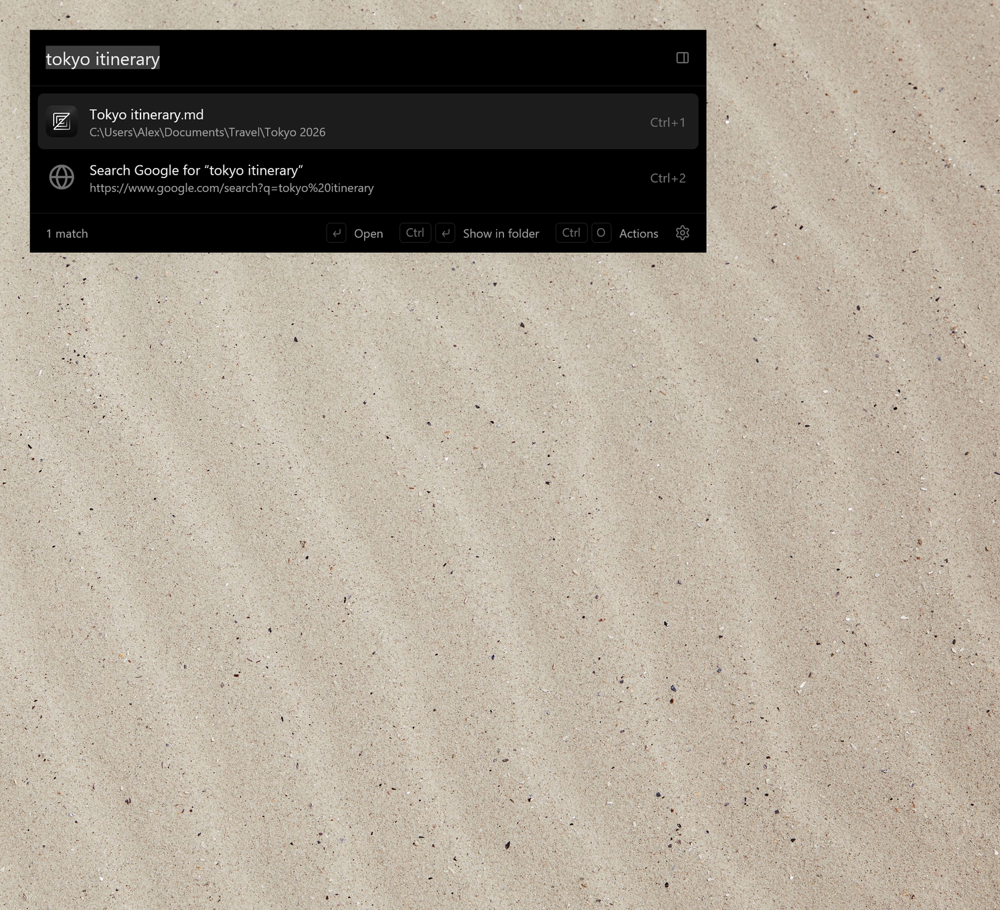
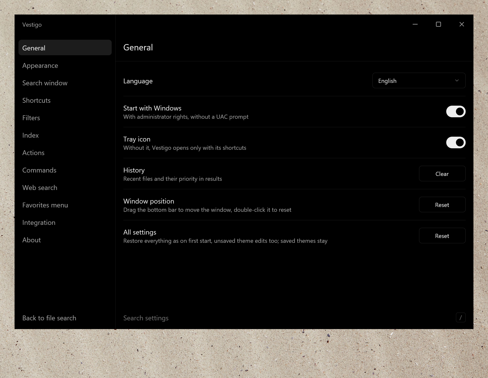

<div align="center">


# Vestigo

Fast file search for Windows.<br>
Press a key, type a few letters, hit Enter.

[](https://github.com/ipavlin98/vestigo/releases/latest)

[](LICENSE)

English | [Русский](README.ru.md)


</div>

<br>

<!-- SHOWREEL: paste the https://github.com/user-attachments/assets/... link of the uploaded showreel video on the next line -->


Vestigo is a search bar for files, folders and apps. It finds them as you type, and it also works where you
usually need a file: inside Explorer windows and in Open and Save dialogs. The name is Latin for "I track down".

It's fast because it never crawls the disk. It reads the NTFS file table (the MFT) once and then follows the change
journal, so a file you just saved is already in the results. On my drive with 1.1 million files and folders the first
scan takes about 2.3 seconds, every later start loads a cache in under 0.1 s, and a search takes 3–5 ms.

Vestigo is written in Rust with [GPUI](https://www.gpui.rs/), the UI framework of the [Zed](https://zed.dev/) editor,
and draws with DirectX. There is no Electron or WebView inside.

## Install

Grab a file from the [latest release](https://github.com/ipavlin98/vestigo/releases/latest):

- `Vestigo-…-setup.exe` is the installer for 64-bit and 32-bit Windows. It picks the right build on its own.
- `Vestigo-…-portable.zip` is the same thing without an installer.
- The files with `arm64` in the name are for Windows on ARM.

You need Windows 10 or 11. The builds aren't signed, so SmartScreen may complain on the first run: click *More info*,
then *Run anyway*.

Once it's running, press **Ctrl twice** or **Alt+Space**.

## What it can do

<table>
<tr>
<td width="50%" valign="top">

### Typos are fine



You don't have to type a name exactly. Initials work (`vsc`), so do a few letters in the right order (`ntpd`), and so
does a query typed in the wrong keyboard layout. Misspellings like `noetpad` are forgiven for apps and for files in the
current folder. Exact matches still come first.<br><br>

</td>
<td width="50%" valign="top">

### Filters in the query



Narrow the results without leaving the bar: `pic: highlands\` for pictures in a folder, `ext:md date:week` for this
week's Markdown files, `size:>10mb` for the big ones. Kinds like `pic:` can be edited, and you can add your own.<br><br>

</td>
</tr>
<tr>
<td width="50%" valign="top">

### Folders from the keyboard



Type a path like `\pictures\` and you get what's in the folder instead of search results. `Alt+L` goes into the
selected folder, `Alt+H` goes back.<br><br>

</td>
<td width="50%" valign="top">

### Search inside documents



`full:cherry blossom` looks inside PDF, Office, text and source files and shows the line it found. This index is off
by default. Turn it on in *Settings → Index → File contents*.<br><br>

</td>
</tr>
</table>

### Preview



`Alt+P` opens a card next to the bar with the picture or the first lines of a text file, plus the size and dates. It
follows the selection as you move through the list.

<table>
<tr>
<td width="50%" valign="top">

### Actions



`Ctrl+O` lists everything you can do with the selected result, the regular Windows context menu included. Any action
can get its own shortcut, and you can add your own programs to the list.<br><br>

</td>
<td width="50%" valign="top">

### Vestigo window



When the bar gets too small, it grows into a full window: kinds with live counts on the side, a date filter, sortable
columns and a preview pane.<br><br>

</td>
</tr>
</table>

### Themes



Light, Dark, Catppuccin Mocha, Dracula and Soft Sand come built in. Accent, background, font, corners, transparency,
blur and shadows each have a single control, and *Fine-tuning* below them gets you to every palette color, window and
element. A theme is a JSON file in `%APPDATA%\Vestigo\themes`; [`base.json`](resources/themes/base.json) shows
everything one can contain.

### A few more things

- Start typing in an Explorer window or on the desktop, and the bar opens with that folder's files on top.
- In Open and Save dialogs the bar sits right under the dialog. `Enter` takes the dialog to the folder you picked,
  `Ctrl+G` to the folder of the last Explorer window.
- Double-click an empty spot in a folder to get a menu with favorites, recent and open folders, and commands.
- The bar runs commands: `cmd`, `psh`, `mkdir Name`, `touch name.txt`, `shutdown`, and any you add yourself.
- It searches the web too: `g weather`, `wiki`, `gh`, `youtube`, and again any you add.
- Scripts can use the local HTTP API, which is off by default:
  `GET http://127.0.0.1:38431/api/v1/search?q=report&limit=50`.

## Shortcuts

| Key | Action |
|---|---|
| Double Ctrl, Alt+Space | open search; press again to expand it into the Vestigo window |
| ↑ / ↓, Tab, Alt+J / Alt+K | select a result |
| Ctrl+1…9 | choose result N |
| Enter | open |
| Ctrl+Enter | show in folder |
| Ctrl+Shift+Enter | run as administrator |
| Ctrl+O, → | actions |
| Ctrl+C / Ctrl+X | copy / cut the file |
| Ctrl+Shift+C | copy the path |
| Alt+L / Alt+H | step into a folder / back |
| Alt+M, letter / Alt+', letter | set a folder mark / jump to it |
| Alt+P | preview |
| Ctrl+click, Shift+click | select several results |
| Esc | close |

## Query syntax

| Syntax | Meaning |
|---|---|
| `tray main` | every word in the name or in a parent folder's name |
| `"q3 plan"` | exact phrase |
| `-draft` | exclude a word |
| `tray\ main` | path: folder parts before `\`, name after |
| `\src\`, `D:\work`, `~\Desktop\` | list a folder; add words to search inside it |
| `ext:pdf;docx`, `*.pdf` | extensions |
| `doc:`, `pic:`, `audio:`, `video:`, `zip:`, `app:`, `folder:`, `file:` | kinds |
| `date:today`, `date:2026-05`, `date:>2026-01` | modification date |
| `size:>10mb`, `size:10mb..1gb` | size |
| `full:contract -draft` | text inside files |

## Administrator rights

Vestigo shows a UAC prompt when it starts, because Windows only lets administrators read the MFT. If you decline, it
still works: it walks the folders the ordinary way, which is slower and has no live updates. Files and programs you
open from Vestigo run with your normal rights unless you pick *Run as administrator*.

## Build

You need Windows 10 or 11, [Rust](https://rustup.rs/) and the Visual Studio C++ build tools.

```
cargo build --release
```

The result is `target\release\vestigo.exe`. Run it with `--window` to open the Vestigo window, `--settings` to open
settings, or `--quit` to close the running copy. [CONTRIBUTING.md](CONTRIBUTING.md) has the rest.

Settings and logs live in `%APPDATA%\Vestigo`, the index and icon caches in `%LOCALAPPDATA%\Vestigo`.

## License

[MIT](LICENSE)
