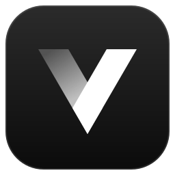
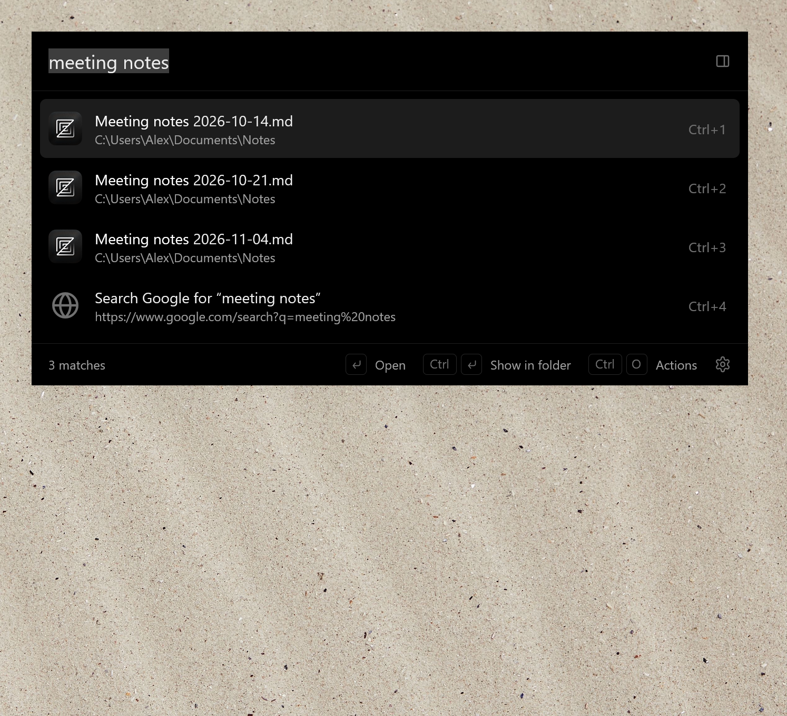
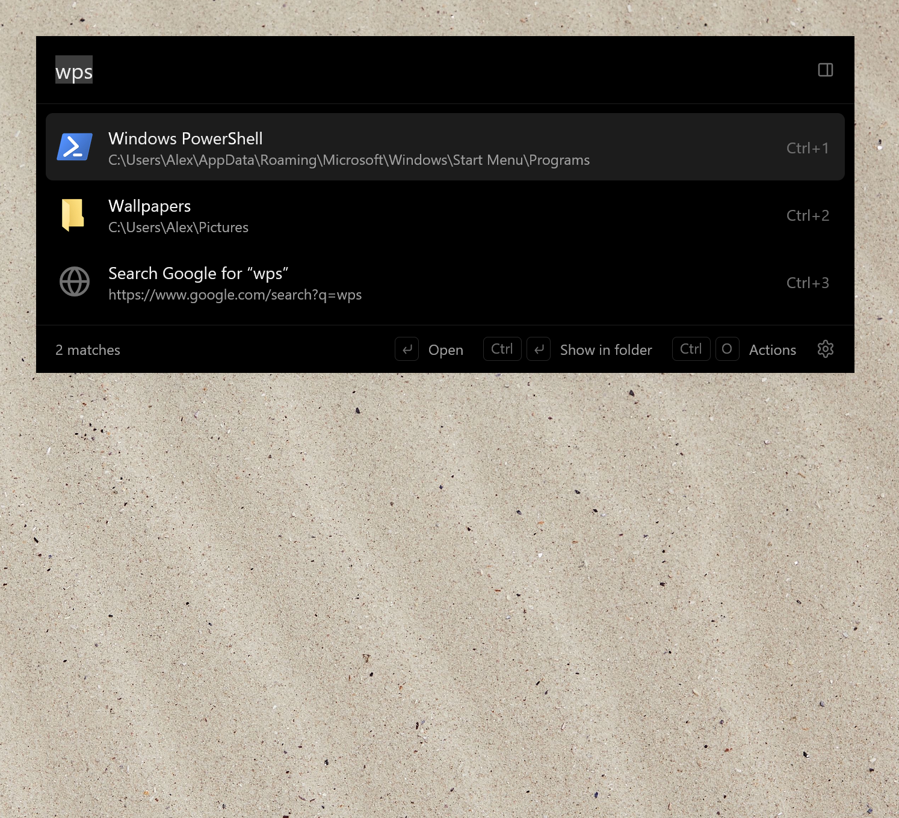
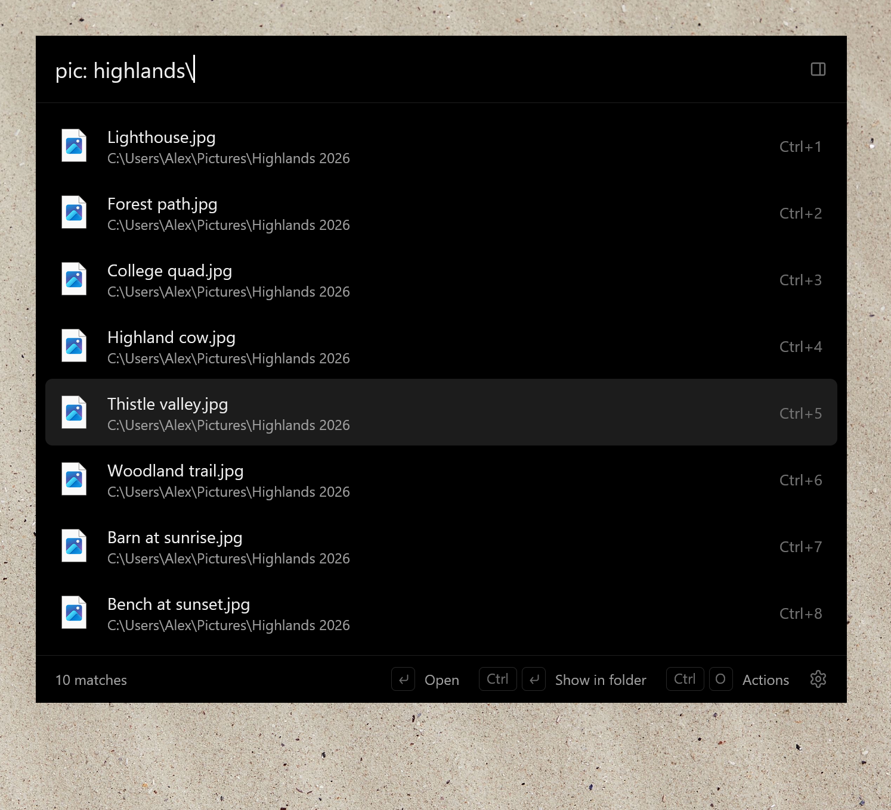
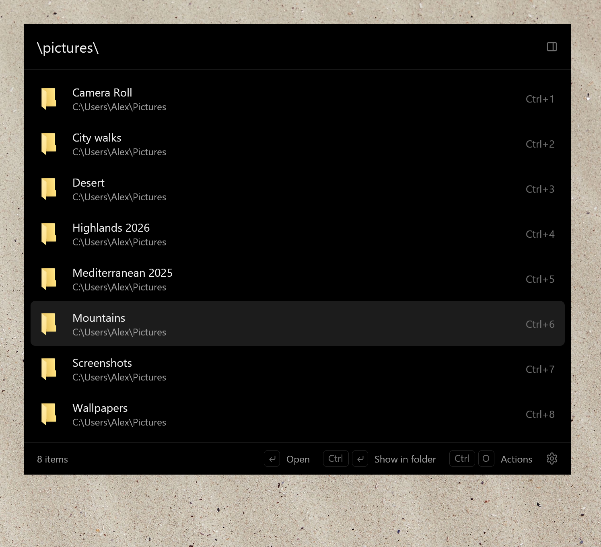
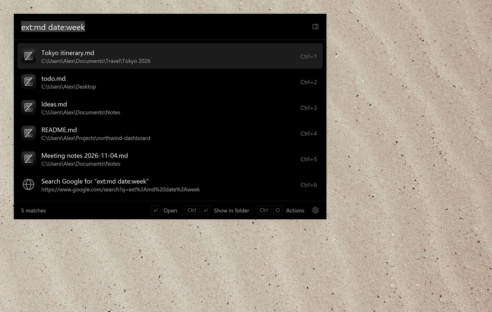
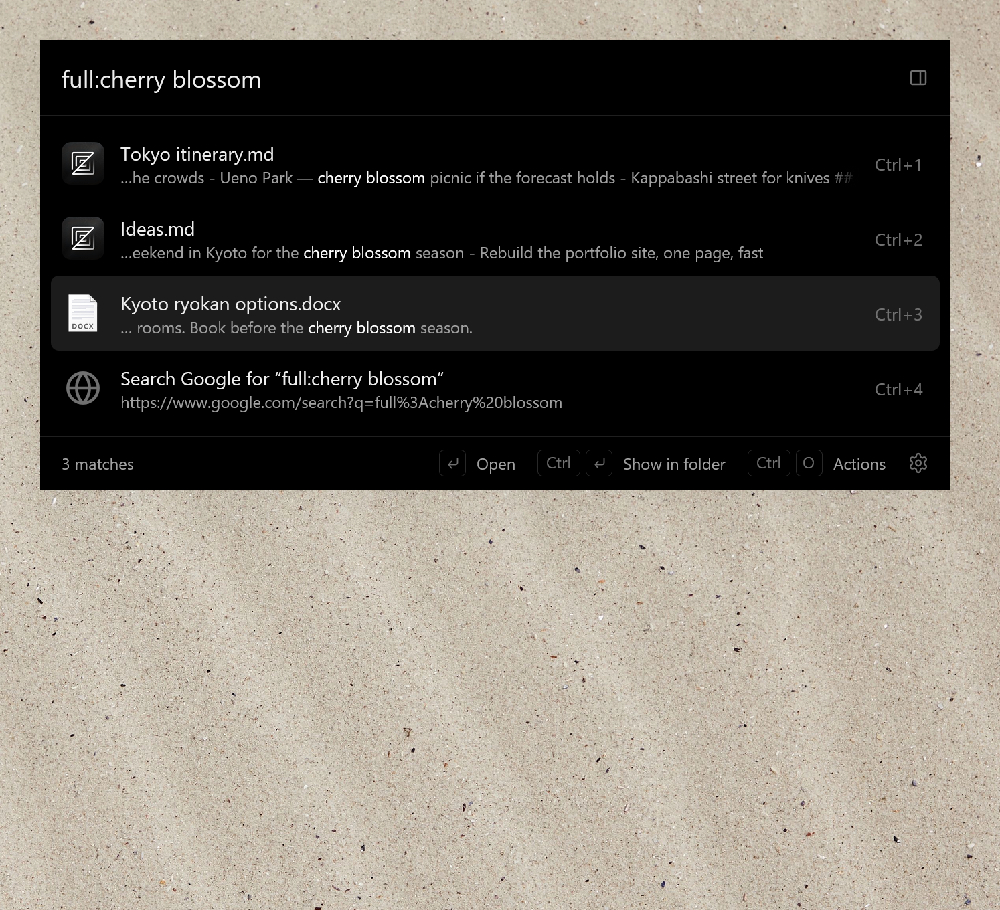
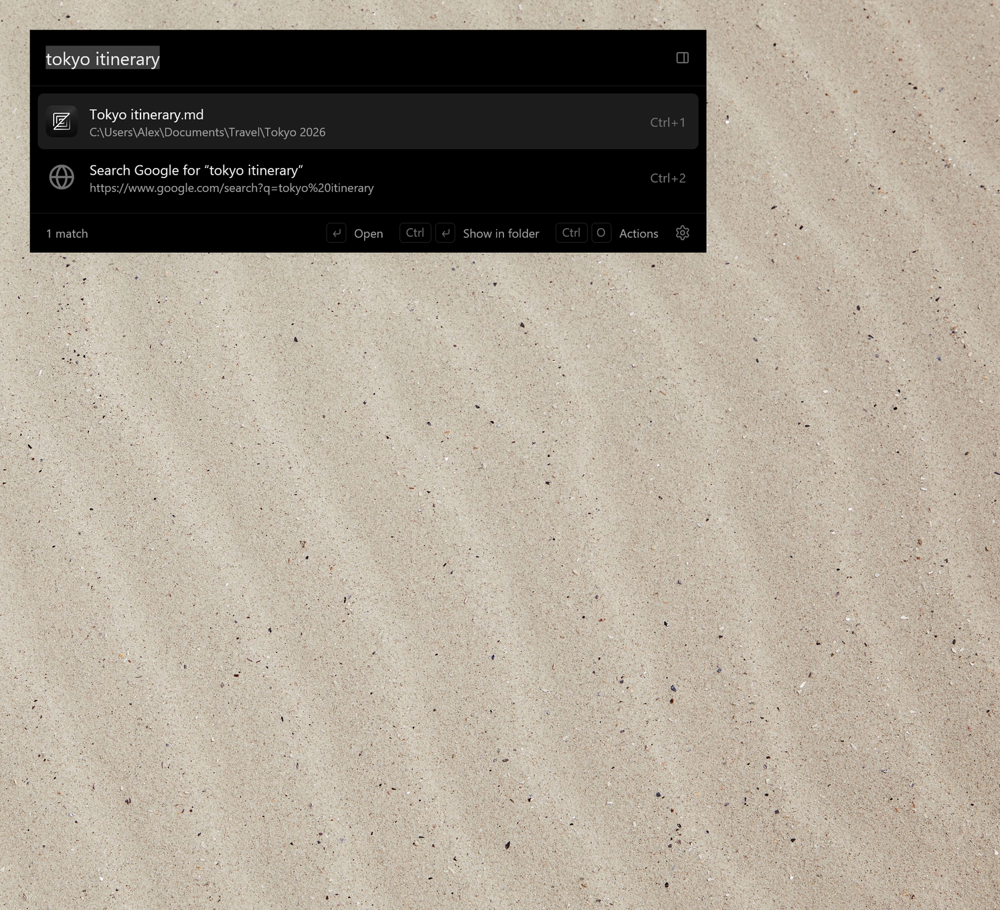
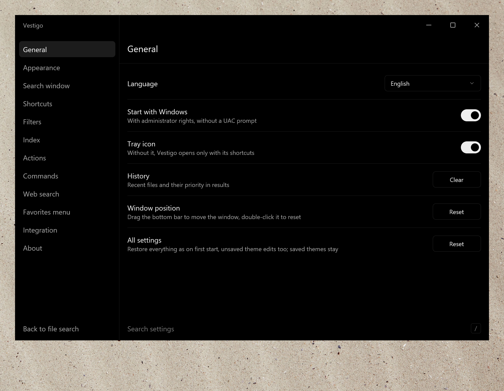

<div align="center">



# Vestigo

Быстрый поиск файлов для Windows.<br>
Нажали клавишу, набрали пару букв, Enter.

[](https://github.com/ipavlin98/vestigo/releases/latest)

[](LICENSE)

[English](README.md) | Русский


</div>

<br>

<!-- SHOWREEL: вставьте на следующей строке ссылку https://github.com/user-attachments/assets/... на загруженный ролик -->


Vestigo — это строка поиска по файлам, папкам и программам. Она ищет прямо по мере ввода и работает там, где файл
обычно и нужен: в окнах Проводника и в диалогах «Открыть» и «Сохранить». Название на латыни значит «выслеживаю».

Работает быстро, потому что не обходит диск. Vestigo один раз читает файловую таблицу NTFS (MFT), а дальше следит за
журналом изменений, так что только что сохранённый файл уже есть в результатах. У меня на диске с 1,1 млн файлов и
папок первое чтение занимает около 2,3 секунды, каждый следующий запуск поднимает кэш быстрее чем за 0,1 с, а сам
поиск идёт 3–5 мс.

Написан на Rust и [GPUI](https://www.gpui.rs/), UI-фреймворке редактора [Zed](https://zed.dev/), рисует через
DirectX. Ни Electron, ни WebView внутри нет.

## Установка

Скачайте файл из [последнего релиза](https://github.com/ipavlin98/vestigo/releases/latest):

- `Vestigo-…-setup.exe` — установщик для 64- и 32-разрядной Windows, нужную сборку он выберет сам.
- `Vestigo-…-portable.zip` — то же самое, но без установки.
- Файлы с `arm64` в имени — для Windows на ARM.

Нужна Windows 10 или 11. Сборки не подписаны, поэтому при первом запуске SmartScreen может ругаться: нажмите
«Подробнее», затем «Выполнить в любом случае».

После запуска нажмите **Ctrl дважды** или **Alt+Space**.

Обновления: Vestigo проверяет GitHub при запуске и раз в сутки и сообщает о новой версии (уведомление из трея и
«Настройки → О программе»). Ничего не устанавливается, пока вы не нажмёте «Обновить»: установленная копия тихо
запускает новый установщик, портативная заменяет свои файлы на месте; обе перезапускаются сами. Отключить проверку
можно в разделе «О программе».

## Что умеет

<table>
<tr>
<td width="50%" valign="top">

### Опечатки не мешают



Набирать имя точно не обязательно. Подойдут первые буквы слов (`vsc`), несколько букв по порядку (`ntpd`) и даже
запрос, набранный не в той раскладке. Опечатки вроде `noetpad` прощаются для программ и для файлов текущей папки.
Точные совпадения всё равно идут первыми.<br><br>

</td>
<td width="50%" valign="top">

### Фильтры прямо в запросе



Сузить результаты можно не выходя из строки: `pic: highlands\` — картинки из папки, `ext:md date:week` — Markdown за
эту неделю, `size:>10mb` — всё, что потяжелее. Типы вроде `pic:` можно править и добавлять свои.<br><br>

</td>
</tr>
<tr>
<td width="50%" valign="top">

### Папки с клавиатуры



Наберите путь, например `\pictures\`, и вместо результатов поиска увидите содержимое папки. `Alt+L` заходит в
выбранную папку, `Alt+H` возвращает назад.<br><br>

</td>
<td width="50%" valign="top">

### Поиск внутри документов



`full:cherry blossom` ищет внутри PDF, документов Office, текстовых файлов и исходников и показывает найденную
строку. По умолчанию этот индекс выключен, включается в *Настройки → Индекс → Содержимое файлов*.<br><br>

</td>
</tr>
</table>

### Предпросмотр



`Alt+P` открывает рядом со строкой карточку: картинка или начало текстового файла, размер и даты. Карточка
переключается вслед за выбранной строкой.

<table>
<tr>
<td width="50%" valign="top">

### Действия



`Ctrl+O` показывает всё, что можно сделать с выбранным результатом, включая обычное контекстное меню Windows. Любому
действию можно назначить своё сочетание клавиш, а в список добавить свои программы.<br><br>

</td>
<td width="50%" valign="top">

### Окно Vestigo



Когда строки мало, она разворачивается в полноценное окно: сбоку типы со счётчиками, есть фильтр по дате, сортировка
по колонкам и панель предпросмотра.<br><br>

</td>
</tr>
</table>

### Темы



В комплекте Light, Dark, Catppuccin Mocha, Dracula и Soft Sand. Акцент, фон, шрифт, углы, прозрачность, размытие и
тени меняются каждый своим переключателем, а *Подробная настройка* под ними даёт добраться до любого цвета палитры,
окна и элемента. Тема — это JSON-файл в `%APPDATA%\Vestigo\themes`; что в нём может быть, видно по
[`base.json`](resources/themes/base.json).

### И ещё

- Начните печатать в окне Проводника или на рабочем столе, и строка откроется с файлами этой папки наверху.
- В диалогах открытия и сохранения строка появляется прямо под диалогом. `Enter` переводит диалог в выбранную папку,
  `Ctrl+G` — в папку последнего окна Проводника.
- Двойной клик по пустому месту в папке открывает меню с избранным, недавними и открытыми папками и командами.
- Из строки запускаются команды: `cmd`, `psh`, `mkdir Имя`, `touch имя.txt`, `shutdown` и любые свои.
- Ищет и в интернете: `g погода`, `wiki`, `gh`, `youtube` и, опять же, что добавите сами.
- Для скриптов есть локальный HTTP API, по умолчанию он выключен:
  `GET http://127.0.0.1:38431/api/v1/search?q=отчёт&limit=50`.

## Клавиши

| Клавиша | Действие |
|---|---|
| Двойной Ctrl, Alt+Space | открыть поиск; нажать ещё раз — развернуть в окно Vestigo |
| ↑ / ↓, Tab, Alt+J / Alt+K | выбрать результат |
| Ctrl+1…9 | выбрать N-й результат |
| Enter | открыть |
| Ctrl+Enter | показать в папке |
| Ctrl+Shift+Enter | запустить от имени администратора |
| Ctrl+O, → | действия |
| Ctrl+C / Ctrl+X | копировать / вырезать файл |
| Ctrl+Shift+C | копировать путь |
| Alt+L / Alt+H | войти в папку / назад |
| Alt+M, буква / Alt+', буква | поставить метку на папку / перейти к ней |
| Alt+P | предпросмотр |
| Ctrl+клик, Shift+клик | выбрать несколько результатов |
| Esc | закрыть |

## Синтаксис запроса

| Запись | Что значит |
|---|---|
| `tray main` | каждое слово есть в имени или в имени одной из папок выше |
| `"q3 plan"` | точная фраза |
| `-draft` | исключить слово |
| `tray\ main` | путь: до `\` части имён папок, после — имя |
| `\src\`, `D:\work`, `~\Desktop\` | содержимое папки; со словами — поиск внутри неё |
| `ext:pdf;docx`, `*.pdf` | расширения |
| `doc:`, `pic:`, `audio:`, `video:`, `zip:`, `app:`, `folder:`, `file:` | типы |
| `date:today`, `date:2026-05`, `date:>2026-01` | дата изменения |
| `size:>10mb`, `size:10mb..1gb` | размер |
| `full:договор -черновик` | текст внутри файлов |

## Права администратора

При запуске Vestigo показывает запрос UAC: читать MFT Windows разрешает только администраторам. Если отказаться, всё
равно будет работать, просто диски придётся обходить по папкам — это медленнее, и изменения не подхватываются на лету.
Файлы и программы, которые вы открываете из Vestigo, запускаются с обычными правами, если не выбрать *Запустить от
имени администратора*.

## Сборка

Нужны Windows 10 или 11, [Rust](https://rustup.rs/) и инструменты сборки C++ из Visual Studio.

```
cargo build --release
```

Получится `target\release\vestigo.exe`. С параметром `--window` он открывает окно Vestigo, с `--settings` —
настройки, а `--quit` закрывает запущенную копию. Остальное описано в [CONTRIBUTING.md](CONTRIBUTING.md).

Настройки и логи лежат в `%APPDATA%\Vestigo`, кэши индекса и иконок — в `%LOCALAPPDATA%\Vestigo`.

## Лицензия

[MIT](LICENSE)
